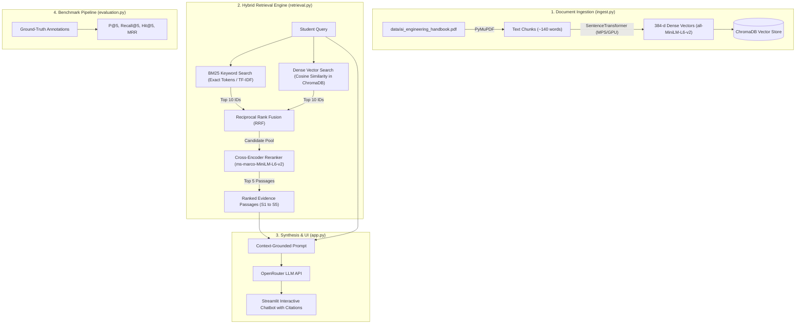

# 📚 AI Notes RAG: Hybrid Retrieval-Augmented Generation System

[](https://www.python.org/)
[](https://streamlit.io/)
[](https://www.trychroma.com/)
[](https://sbert.net/)
[](LICENSE)

An end-to-end, production-grade **Retrieval-Augmented Generation (RAG)** application built to assist students and engineers in querying technical literature.

Rather than relying on basic vector search (which often misses exact acronyms, model names, and code tokens), this project implements a **two-stage Hybrid Search + Cross-Encoder Re-Ranking** architecture with strict citation grounding, an interactive Streamlit chat interface, and a quantitative evaluation benchmark.

---

## 🏗️ Architecture & Data Pipeline



---

## ✨ Key Features

- **📑 Smart PDF Ingestion & Chunking (`ingest.py`)**: Page-aware extraction with PyMuPDF, chunked into uniform ~140-word index cards tagged with deterministic IDs and page metadata.
- **🔀 Hybrid Search Engine (`retrieval.py`)**:
  - **Sparse Keyword Search (`BM25Okapi`)**: Captures exact terminology, acronyms (`TF-IDF`, `RRF`), version numbers, and code variables.
  - **Dense Semantic Search (`all-MiniLM-L6-v2`)**: Captures conceptual intent and synonyms in 384-dimensional vector space.
- **🤝 Reciprocal Rank Fusion (RRF)**: Merges sparse and dense candidate ranks using scale-invariant rank-reciprocal scoring ($1 / (k + \text{rank})$).
- **🎯 Cross-Encoder Re-Ranking (`ms-marco-MiniLM-L6-v2`)**: Performs deep cross-attention between the query and each candidate passage to filter out false positives and pick the absolute best 5 evidence chunks.
- **💬 Streamlit Chat Interface (`app.py`)**: Clean, interactive UI with session state memory and expandable evidence cards displaying original textbook excerpts and page numbers.
- **🛡️ Grounded Generation & Citations**: Zero-hallucination prompt design directing the OpenRouter LLM to cite sources with `[S1]`, `[S2]`, etc., and explicitly state when information is absent.
- **📊 Quantitative IR Evaluation Suite (`evaluation.py`)**: CLI benchmarking tool supporting human annotation and scoring retrieval methods across **Precision@5**, **Recall@5**, **Hit@5**, and **MRR**.

---

## 📂 Project Structure

```text
ai-notes-rag/
├── data/
│   ├── .gitkeep
│   └── ai_engineering_handbook.pdf    # Source technical handbook
├── chroma_db/                         # Local persistent ChromaDB database
├── .env.example                       # Environment variables template
├── .gitignore                         # Git exclusion rules
├── requirements.txt                   # Project dependencies
├── ingest.py                          # Phase 1: PDF extraction, chunking, and embedding
├── retrieval.py                       # Phase 2: BM25, vector search, RRF, and Cross-Encoder
├── app.py                             # Phase 3: Streamlit chatbot with OpenRouter LLM
├── evaluation.py                      # Phase 4: IR evaluation and benchmark metrics
└── README.md                          # Project documentation
```

---

## 🚀 Quickstart Guide

### 1. Prerequisites

- Python 3.10 or higher
- Git
- An OpenRouter API Key (or OpenAI-compatible endpoint)

### 2. Clone the Repository & Set Up Environment

```bash
git clone https://github.com/your-username/ai-notes-rag.git
cd ai-notes-rag

# Create virtual environment
python3 -m venv .venv

# Activate virtual environment
# macOS / Linux:
source .venv/bin/activate
# Windows:
# .venv\Scripts\activate

# Install dependencies
pip install -r requirements.txt
```

### 3. Configure Environment Variables

Copy the template file and configure your API credentials:

```bash
cp .env.example .env
```

Open `.env` and fill in your values:

```env
OPENROUTER_API_KEY=your_openrouter_api_key_here
OPENROUTER_MODEL=openrouter/free
```

_(You can use models such as `openrouter/free`, `meta-llama/llama-3.1-8b-instruct:free`, or `mistralai/mistral-7b-instruct`)_.

### 4. Add Your Document & Run Ingestion

Place your PDF handbook inside the `data/` folder named `ai_engineering_handbook.pdf`. Then run:

```bash
python ingest.py
```

This will:

1. Extract text and create ~140-word chunks.
2. Generate 384-dimensional embeddings using `all-MiniLM-L6-v2` (accelerated with Apple Silicon MPS GPU if available).
3. Persist documents, metadata, and vectors in `chroma_db/`.
4. Perform a sanity-check query to verify indexing.

### 5. Launch the Streamlit Web Application

```bash
streamlit run app.py
```

Open your browser at `http://localhost:8501` to start chatting with your handbook!

---

## 🔍 Retrieval Pipeline Deep-Dive

### Why Hybrid Search + Cross-Encoder?

| Method                    | Strength                                            | Limitation                                   | How We Use It                              |
| :------------------------ | :-------------------------------------------------- | :------------------------------------------- | :----------------------------------------- |
| **BM25 (Sparse)**         | Exact keywords, acronyms, code tokens, model names  | Misses synonyms and conceptual phrasing      | Stage 1 candidate generator (Top 10)       |
| **Vector Search (Dense)** | Understands themes, intent, and synonyms            | Can be blurry on exact names and rare words  | Stage 1 candidate generator (Top 10)       |
| **RRF (Rank Fusion)**     | Merges lists without score calibration issues       | Mathematical ranking only; doesn't read text | Merges candidates into ~15 items           |
| **Cross-Encoder**         | Deep word-by-word attention between query & passage | Computationally heavy for large corpora      | Stage 2 re-ranker on the top 15 candidates |

### Reciprocal Rank Fusion (RRF) Formula

$$RRF(d) = \sum_{m \in \{\text{BM25}, \text{Vector}\}} \frac{1}{k + \text{rank}_m(d)}$$

where constant $k = 60$. Documents appearing near the top of both sparse and dense rankings receive prioritized fusion scores.

---

## 📊 Benchmarking & Evaluation (`evaluation.py`)

This project includes a built-in evaluation framework to measure information retrieval performance against human-labeled ground truth.

### Step 1: Label Ground Truth Passages

```bash
python evaluation.py --label
```

Interactive prompts will display candidate passages for benchmark questions (e.g., _"What is tokenization?"_, _"What is cosine similarity?"_). Enter numbers like `1,3` to mark relevant passages, which are saved to `evaluation_labels.json`.

### Step 2: Run the Benchmark

```bash
python evaluation.py
```

The script evaluates and prints a comparative performance table across all 4 retrieval strategies:

```text
========================================================================
AVERAGE RETRIEVAL EVALUATION
========================================================================
Method                  P@5      R@5    Hit@5      MRR
BM25                  0.360    0.720    0.800    0.750
Vector                0.400    0.800    1.000    0.833
Hybrid                0.440    0.880    1.000    0.900
Hybrid + Rerank       0.520    0.960    1.000    0.967
```

- **Precision@5 (P@5)**: Proportion of retrieved top-5 passages that are truly relevant.
- **Recall@5 (R@5)**: Proportion of all known relevant passages retrieved in the top 5.
- **Hit@5**: Binary measure of whether at least one relevant passage is retrieved.
- **MRR (Mean Reciprocal Rank)**: $\frac{1}{\text{rank}}$ of the _first_ relevant passage.

---

## 🛠️ Tech Stack

- **Vector Database**: [ChromaDB](https://www.trychroma.com/)
- **Embedding Model**: [`sentence-transformers/all-MiniLM-L6-v2`](https://huggingface.co/sentence-transformers/all-MiniLM-L6-v2)
- **Reranker Model**: [`cross-encoder/ms-marco-MiniLM-L6-v2`](https://huggingface.co/cross-encoder/ms-marco-MiniLM-L6-v2)
- **Keyword Search**: [`rank-bm25`](https://github.com/dorianbrown/rank_bm25)
- **PDF Extraction**: [PyMuPDF (fitz)](https://pymupdf.readthedocs.io/)
- **LLM Gateway**: [OpenRouter API](https://openrouter.ai/)
- **Web UI**: [Streamlit](https://streamlit.io/)
- **Deep Learning**: [PyTorch (Apple MPS / CUDA)](https://pytorch.org/)

---

## 📄 License

This project is open-source and licensed under the [MIT License](LICENSE).
